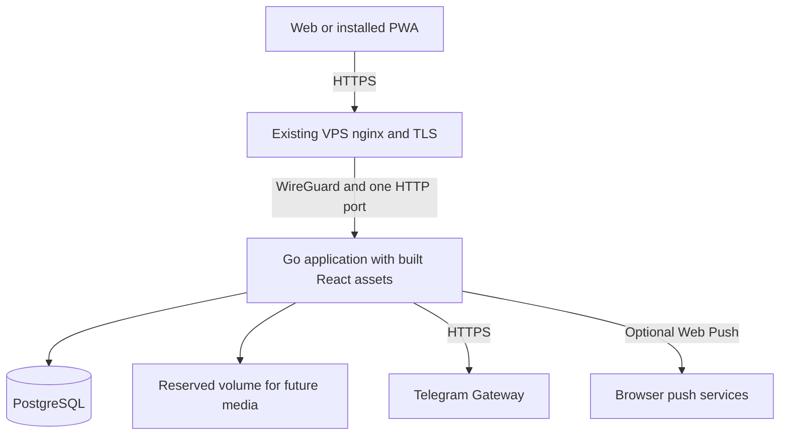

# Draft Technical Design and Build Plan

Native Space page: [Open in Space](https://chatgpt.com/space/page_0da7058a10148191a17f468709afbc18)  
Space snapshot: 4 November 2026

[Project Home](project-home.md) · [Agreed MVP scope](mvp-and-roadmap.md) · [Decision register](decisions-and-open-questions.md)

**Owner:** Altay  
**Updated:** 4 November 2026  
**Status:** Draft design with all agreed MVP feature slices implemented and deployed; detailed defaults and public-pilot operations remain reviewable

BIKERS.KZ will launch as a web/PWA using React, TypeScript, Vite, Go, and PostgreSQL. This draft turns the agreed scope into an implementation design. The first internal milestone is one complete journey: Telegram OTP → rider profile → create or join a ride → coordinate in its Ride Room.

The product scope and stack are confirmed in D-010–035. Organizer approval and ride-preview/participant access are confirmed in D-036. Backend package ownership and dependency direction follow the repository's approved `AGENTS.md` instructions (D-038). Owner-approved club membership and the owner’s transfer-or-close requirement are confirmed in D-039. Automatic model pictures must match the verified model year/generation, with no image when unavailable (D-040). The remaining schema, endpoint shapes, policies, numeric limits, and build order below are recommendations for review. They do not silently approve unresolved product behavior or commit dates.

## Confirmed constraints

- Launch in Kazakhstan with English, Russian, and Kazakh across onboarding, core actions, notifications, and errors.

- Web/PWA first; mobile apps later, reusing the backend. Mobile framework and timing remain open.

- React/TypeScript/Vite frontend, Go application server, PostgreSQL, persistent photo storage.

- Telegram Gateway OTP is the only MVP user signup/login method. Users need a Telegram-registered phone number. Phone OTP never awards the admin-assigned profile badge.

- One Docker Compose stack on the homelab Mac mini. The public VPS terminates HTTPS and proxies over WireGuard to one application HTTP port. Datastores stay internal.

- Organizer approval is required for ride join requests. Public previews contain city, date, and a short description; exact meeting details, participant list, chat, and photos require approved-participant access.

- The MVP includes the agreed limited rides, rooms, profiles, garages, clubs, albums, links, external navigation, privacy/moderation, manual badges, and locale capabilities.

Feeds, general posts, commerce, live tracking, route/place libraries, standalone events, native video/streaming, assistance, rewards, and advanced garage/club tools stay deferred. The complete catalogue remains the long-term record.

**Subsequent scope decisions:** Private ride-plan maps/routing (#18) and curated useful places (#22/#24) supersede their original deferrals. On 11 November 2026, [#35](https://github.com/unstppbl/bikers/issues/35) approved community routes, private saved collections, foreground in-app GPS recording and dated condition reports. Tracks remain private until explicit consent publishes a separate public route snapshot; there is no GPX import or guaranteed background recording. Live group-location sharing remains deferred. See the [feature backlog](feature-backlog.md) for current scope and implementation status.

## Proposed runtime and modules

Use one deployable Go application with domain modules and PostgreSQL. Bike photos, club images, avatars and ride photos store bounded processed JPEG bytes alongside their metadata, making image changes and database backups atomic. PostgreSQL also holds durable inbox/outbox, session-bound push subscriptions and audited moderation state. A push worker polls through a manager interface; there is no media worker or file/object-storage adapter. MEDIA_DIR remains reserved for future storage.



The PWA and HTTP API share one public origin. Go serves the production Vite assets and server-rendered public ride/club preview metadata. Node is needed to build the frontend, not as another production application process. [Vite production builds](https://vite.dev/guide/build), [Go embedded files](https://pkg.go.dev/embed).

| Module | Responsibility and interface |
| --- | --- |
| Accounts | Issue and verify OTP challenges; manage stable users, onboarding, sessions, and account status |
| Rides | Create and update plans; govern participation, capacity, cancellation, and authoritative plan versions |
| Conversations | Persist room messages and retrieve history; send updates only to authorized participants |
| Garage | Manage owned bikes and private maintenance records |
| Clubs | Manage one owner, members, club details, and linked rides |
| Media | Validate, transform, store, authorize, and delete image assets |
| Moderation | Handle reports, blocks, administrator actions, and manual badge grants |
| Delivery | Persist notification intent, retry delivery, and reconcile failures |

Keep module interfaces small. Managers own application rules, authorization decisions, limits, and transaction coordination. Shared records, serialization, and pure value validation belong in `models`; repository interfaces and callback types belong in `database`. PostgreSQL owns queries, mappings, locks, and transaction boundaries, running manager decisions through local callbacks and revalidating locked state before applying changes. External service calls run outside database locks. HTTP/WebSocket resources call managers and map responses; `app` constructs and wires dependencies. The `architecture` command checks every internal Go import, including tests and build-tagged files. See `docs/backend-architecture.md` for the complete package map and dependency rules.

The implemented repository layout follows the backend package-ownership instructions in `AGENTS.md`:

```text
apps/backend/cmd/{api,architecture}
apps/backend/internal/app
apps/backend/internal/config
apps/backend/internal/models
apps/backend/internal/database
apps/backend/internal/database/postgres
apps/backend/internal/managers/{accounts,clubs,garage,media,notifications,photos,rides,rooms,system,trust}
apps/backend/internal/clients/{telegram,webpush}
apps/backend/internal/workers
apps/backend/internal/resources/http
apps/web/src
docs
Dockerfile
docker-compose.yml
.env.example
README.md
```

Pin supported package and container versions during foundation work. Use versioned SQL migrations and an explicit migration command. Do not run destructive schema changes automatically when the web process starts.

## Proposed data model

Use stable UUID user IDs; a phone number is a private login attribute, not the identity used by other tables. Validate and normalize phone numbers to E.164, with a unique constraint. Foreign keys and unique constraints enforce ownership and membership relationships.

| Records | Essential data and rules |
| --- | --- |
| Users and profiles | User ID, unique private phone, account status; display name, avatar, city, languages, interests, independent locale settings |
| OTP challenges | Internal challenge ID, provider request ID, stored phone, purpose, state, expiry, attempt/send counters, consumed time |
| Sessions | Token digest, user, created/last-seen times, idle/absolute expiry, revocation, CSRF material |
| Model catalogue and aliases | Canonical make/model plus curated Cyrillic/Latin spellings and common aliases; public reference photos with verified year bounds, local asset paths, dimensions, and source/author/license metadata |
| Bikes and maintenance entries | Owner, model, year, photo references; private service date, mileage, and work performed |
| Clubs and memberships | One owner; member state and timestamps; unique club/user pair |
| Rides and participation | Organizer, optional club, title, time, meeting information, destination/link, expectations, capacity, visibility, status, plan version; unique ride/user pair |
| Room messages | Ride/room, sender, per-room sequence, client message ID, body, moderation state, timestamps |
| Media assets and albums | Bike photos, club images, avatars and participant-only ride photos: immutable uploader attribution, owning scope, pending/ready state, quota reservation, processed JPEG bytea, dimensions/size/expiry and version fences; external HTTPS video links |
| Reports and blocks | Reporter/blocker, target, reason, state, responsible admin, action history |
| Badge grants | Implemented Community verified user badge; audited admin grant/revoke and reason; community signal only, with criteria requiring review |
| Notifications and outbox | Recipient, event ID/type, payload reference, delivery state, retry time, deduplication key |
| Push subscriptions and audit events | Session-bound browser subscription and leased push deliveries; restricted, reasoned records of privileged actions |

Index upcoming rides by city, time, visibility, and status; messages by room/sequence; maintenance by bike/date; pending jobs by state/next attempt. Store ride instants as PostgreSQL timestamps with time zone and retain the ride's display timezone. Use a date for a maintenance service date. The proposed launch timezone is Asia/Almaty; the host timezone must not determine business rules.

## Proposed account and session flow

### Telegram challenges

Adapt the existing Telegram client instead of copying its account flow. Its current verification helper discards the verification result, and its existing caller accepts a submitted phone without binding it to the original challenge. Both behaviors must change in the BIKERS.KZ implementation.

1. Normalize and validate the phone; apply send limits; create a server-owned challenge.

2. Ask Telegram to generate a six-digit code and return its provider request ID. Keep that ID and the original phone server-side; return only the internal challenge ID to the PWA.

3. Accept the internal challenge ID and entered code. Check local state and expiry, and reserve a verification attempt atomically before calling the provider. Require `verification_status.status == code_valid` and a returned phone matching the stored challenge; reject missing, invalid, expired, exhausted, or mismatched results. API-request success alone is insufficient.

4. Resolve the account from the stored phone. Atomically consume the challenge and create a session, protected by unique-phone and single-consumption constraints.

5. A new user continues to the profile flow; a returning active user enters the app. Suspended/deleted account policy must be explicit before the pilot.

Telegram supports generated codes and a verification status distinct from API success. This design uses that distinction rather than treating delivery as authentication. [Telegram Gateway API](https://core.telegram.org/gateway/api).

Proposed initial limits: five-minute local challenge expiry, sixty-second resend cooldown, at most five verification attempts or the provider's lower limit, and three sends per phone per fifteen minutes. Add configurable source-based limits and an operator-controlled delivery budget. These numbers are draft defaults.

Single-use consumption must survive concurrent requests. A lost success response may require a fresh challenge; a consumed challenge must not authenticate again. If Telegram accepted a send but the response was lost, record an uncertain outcome and apply the resend policy; do not blindly retry a billable send. Bound network calls with context/timeouts, parse typed responses, and mask phone numbers in logs. Codes, tokens, and session secrets never enter logs.

### Sessions and account lifecycle

For the PWA, propose random opaque server-managed sessions stored as digests in PostgreSQL, exchanged through a host-only `__Host-bikerskz_session` cookie with Secure, HttpOnly, SameSite=Lax, Path=/, and no Domain attribute. Do not store authentication tokens in browser localStorage. Use same-origin requests, CSRF protection on state changes, and a strict origin check on WebSocket upgrades. Revalidate long-lived sessions and close associated connections on expiry, logout, or revocation. Session transport belongs to the web adapter; future mobile credential transport remains a separate design task. [OWASP session guidance](https://cheatsheetseries.owasp.org/cheatsheets/Session_Management_Cheat_Sheet.html), [OWASP WebSocket guidance](https://cheatsheetseries.owasp.org/cheatsheets/WebSocket_Security_Cheat_Sheet.html).

Proposed rider-session limits are seven days idle and thirty days absolute. Rotate on authentication or privilege change. Logout revokes the server session; suspension revokes access and active connections. Platform-admin sessions and fresh OTP requirements for privileged actions need a reviewed policy.

Keep phone numbers out of profiles, previews, analytics payloads, and ordinary client-visible audit data. Account identity persists across a legitimate phone change. Require proof of the current session/number and the new number before an automated change; if current access is lost, recovery remains a documented unresolved policy. No email, password, SMS, or social-login fallback is introduced by this design.

## Proposed permissions and public previews

Derive the actor from the session, never from a submitted user ID or role. Apply authorization to HTTP operations, message history, media downloads, preview HTML, and realtime subscriptions.

| Actor | Proposed access |
| --- | --- |
| Anonymous visitor | Only fields explicitly allowed in a public ride/club preview or an explicitly shared basic motorcycle page |
| Signed-in rider | Own profile, bikes, private log, and permitted public discovery |
| Approved ride participant | Current plan, participant-visible details, room conversation, and permitted album |
| Ride organizer | Own ride plan, participation decisions, cancellation, announcements, and ride moderation within defined limits |
| Club owner | Own club details and membership administration. Proposed linked-ride administration grants no participant-only meeting details, roster, chat, or photos unless the owner is also an approved participant or organizer; no private garage access |
| Platform administrator | Reports, moderation, account restrictions, and manual badge grants, with audit history |

**Confirmed ride policy — 3 November 2026:** The organizer approves join requests. Public previews show city, date, and a short description. Exact meeting details, the participant list, chat, and photos are visible only to approved participants.

**Still proposed:** Club-only rides additionally require active club membership. Club-specific eligibility and member-removal behavior remain separate design recommendations.

One club owner is supported initially. Confirmed membership rules require riders to request membership, the owner to approve/remove members, and the owner to transfer ownership or close the club before leaving. The current implementation transfers ownership only to an approved member, keeps the previous owner as a member, makes closed clubs read-only, and restricts the roster to approved members. These detailed defaults remain reviewable. Being a club owner or organizer does not confer a platform-admin role. Platform administrators do not inherit routine access to private maintenance logs; any exception needs a separately reviewed access policy. Bootstrap the first platform administrator through an operator command, never public signup fields.

Current basic clubs link public ride previews only. Club membership or ownership never approves ride participation or grants private ride details, roster, chat, or photos. Linking requires the club owner to organize the ride; a new club owner can remove an existing association without changing the ride. Club-only ride eligibility and revocation remain proposed future behavior; no club-only visibility mode is implemented. Proposed club-ride policy: only the club owner creates or links a club-only ride. Losing club membership revokes access to existing club-only ride rooms, history, albums, and active subscriptions. Removal from an individual ride revokes that ride's access separately. Ownership transfer must reassign club-ride administration explicitly without automatically granting participant-only data access; the new owner must also be an approved participant or organizer to read that data. Perform membership/ride permission changes and their revocation events consistently. Cancellation preserves a clearly marked plan and history for authorized participants rather than silently deleting the ride. Final retention/account-deletion behavior remains open.

**Implemented shared-room default, subject to review:** Bilateral blocking prevents new ride/club joins and approvals with the organizer/owner. Existing approved memberships keep plans, roster, cancellation and organizer announcements; ordinary chat, contextual avatars and private album media from blocked users are filtered. Published basic bikes/clubs and their public images remain public. Moderation hides public discovery/content while retaining approved coordination and scoped evidence review. Community verified is an audited, manually assigned user badge, explicitly separate from identity, licence, skill or safety verification; recipient criteria and moderator responsibility need acceptance before a public pilot.

## Proposed HTTP API

Use JSON endpoints under /api/v1, with an OpenAPI contract and shared error codes. The server owns validation, authorization, and business rules; the PWA renders them in the selected language.

| Area | Proposed operations |
| --- | --- |
| Authentication | POST /auth/challenges; POST /auth/challenges/verify; GET /session; DELETE /session |
| Profile and catalogue | GET/PATCH /me/profile; GET /bike-models?query= |
| Rides | GET/POST /rides; GET/PATCH /rides/{id}; POST /rides/{id}/cancel |
| Participation | PUT/DELETE /rides/{id}/participation; organizer decision operations |
| Conversation | GET/POST /rides/{id}/messages; one authenticated WebSocket endpoint for events |
| Garage | Bike and maintenance-entry operations scoped to the current owner |
| Clubs | Club and membership operations scoped to owner/member permissions |
| Media | Upload/finalize and authorized asset reads; album operations scoped to the ride |
| Moderation | Reports, blocks, admin queue/actions, and audited badge grant/revoke operations |

Use cursor pagination and bounded page sizes. Return stable machine codes, localized-message keys, and a request ID without leaking secrets. Use explicit plan versions for edits and conflict responses for stale submissions. Make joins, sends, and other retryable commands idempotent. Render only permitted public fields into share metadata; a frontend visibility toggle is not an authorization check.

## Proposed ride and room behavior

A ride moves through draft, published, and cancelled states. A past departure time does not prove that the outing happened or that anyone attended; completion and attendance tracking remain separate design topics. Participation has requested, approved, rejected, left, and removed states. Only approved participation counts toward capacity and grants room access. The proposed capacity rule includes the organizer in the displayed participant limit; pending requests do not reserve places.

Lock the same ride state during participation changes, capacity edits, and cancellation so simultaneous joins cannot overbook and an approval cannot commit after cancellation. Recheck the ride status inside the transaction before committing. Keep the participation row unique per ride/user and apply authorization again when the state changes. PostgreSQL row locks can coordinate those concurrent writers. [PostgreSQL locking documentation](https://www.postgresql.org/docs/current/explicit-locking.html).

Store each message before acknowledging or broadcasting it. Use unique constraints on (room, sender, client message ID) and (room, sequence). Repeating a message ID with a different body returns a conflict. Allocate each room sequence under a room-level transactional lock held until commit, so reconnect cursors cannot skip a lower sequence that commits late. Connection loss does not erase messages; the client fetches committed messages after its last acknowledged sequence.

Persist significant plan changes/cancellation and notification intent in the same transaction. Retry delivery with deduplication; do not promise exactly-once push delivery. Recheck recipient access at dispatch, not only when the event was created. Check the current session/account and membership when subscribing, sending, reading history, and delivering events; close subscriptions on expiry, logout, suspension, or access revocation.

Treat chat as plain text, escape user-supplied profile/ride/club/preview content, and reject unsafe link schemes. The current plan and organizer announcements remain visible separately from conversation text. Proposed significant changes are departure time, meeting point, destination/route, and cancellation; cosmetic edits should not trigger a full notification blast. Automatic reminders, read receipts, typing indicators, and direct messages are not added to MVP acceptance criteria.

## Proposed photos and links

All photo access passes through the owning object's permissions. Bike photos use a separate authorized gallery/content API; the existing five-field public bike record stays unchanged. Private bikes return no photos to strangers, and public bike photos become public only with the bike. Every GET/HEAD rechecks access and returns no-store; source filenames and originals are not retained. The catalogue cover remains selected after upload until the owner deliberately chooses an uploaded photo; deleting that cover restores the catalogue (D-041). Club images use separate metadata/content endpoints without changing Club DTOs. As an implementation default, the image is public with the basic club page, including after closure; closed clubs reject image changes. Active owners upload, replace, or remove one image. Failed replacements retain the old image, and successful replacement/removal invalidates its old URL. Ownership transfer preserves the image under the new owner’s control; transfer, closure, or version changes during processing reject the unfinished upload.

Shared bike-photo and club-image defaults: JPEG/PNG/WebP source up to 12 MiB, 32 megapixels and 12000 pixels per edge; normalize EXIF orientation, flatten alpha on white, and encode a fresh JPEG up to 1920 pixels per edge and 4 MiB. EXIF/GPS metadata is stripped; animated images and unsupported formats are rejected. HEIC requires exporting as JPEG. Metadata parsing is synchronous with bounded work, so it cannot continue after releasing the processing slot. Broader ride-album limits and device testing remain proposed. [OWASP upload guidance](https://cheatsheetseries.owasp.org/cheatsheets/File_Upload_Cheat_Sheet.html).

All image uploads reserve shared capacity before body reading. Bikes allow six photos, clubs and profiles one current image plus one pending replacement. Ride albums allow 24 photos/six per uploader and twelve HTTPS video links/three per uploader. Across all four image tables, defaults are 100 MiB per original uploader, 1 GiB global payload, two processors and twelve attempts per uploader/hour; pending reservations expire after ten minutes. Every path expires/counts all tables. The trust advisory lock precedes the photo key and entity locks; managers revalidate account, membership/ownership, status, versions and expiry. Ride finalization fences removal/reapproval and plan changes. Replacements commit bytes and references atomically. These are implementation defaults; total disk/WAL/backup capacity remains an operational check.

For a future file/object-storage design, consider pending, ready, and failed asset states, atomic file moves with database state transitions, and retryable reclamation of temporary files and deleted variants. The current PostgreSQL image implementation use pending/ready records, atomic database transactions, and lazy pending expiry instead.

External videos and navigation routes remain ordinary validated HTTP/HTTPS links. The MVP does not fetch arbitrary remote URLs to produce previews or embed video infrastructure. Ride/club share previews are generated from authorized application data.

## Proposed notifications localization and PWA behavior

Keep durable in-app notifications in PostgreSQL. Use the event connection for foreground updates and opt-in standards-based Web Push for significant ride changes/cancellation. Push failure must not remove the in-app notice. Prefer minimal lock-screen content; fetch sensitive details after authentication.

iPhone Web Push requires a Home Screen web app and a permission request initiated by the user. Include install/enable instructions and test actual devices. Notification permission is optional and must not prevent joining a ride. [WebKit Web Push documentation](https://webkit.org/blog/13878/web-push-for-web-apps-on-ios-and-ipados/).

Cache the application shell and versioned public assets. Do not service-worker-cache OTP responses, private API data, chat history, or protected photos. Send no-store cache headers for protected responses and clear client-held private state on logout. Offline mode shows connection state and disables writes; queued offline mutations are a later capability.

Use translation keys for UI, API errors, and notification templates from the first build phase. Store UI language separately from profile languages, country, currency, and city. Basic model lookup uses curated aliases; it does not imply automatic user-content translation or a new search service.

## Proposed deployment and operations

Build the Vite frontend and Go executable in a multi-stage Docker build. Run the application as a non-root user with one configurable HTTP listener, persistent media, and an internal PostgreSQL connection. The Compose file includes restart policies and healthchecks. Follow the existing homelab contract; do not add an application-side TLS proxy.

Accept forwarded scheme/client information only from configured trusted proxy peers, validate the configured public host/origin, and keep the public base URL in an environment variable. This preserves HTTPS cookie behavior at the public edge while the application listens over plain HTTP through the private tunnel.

Configuration includes the base URL, application port, database connection, Telegram Gateway token, media path, trusted proxy settings, timezone, session/OTP limits, and optional Web Push keys. Commit examples only. Choose the host port after checking the actual server; no proposed number is assumed free.

Provide /health/live and /health/ready. Readiness checks database connectivity/schema compatibility and required storage availability. Use structured request/event logs, masked identifiers, and operational counters for provider errors, failed logins, message delivery, job backlog, storage usage, and backup freshness. Existing operator-alert infrastructure can be reused after its access settings are checked; rider notifications remain per-user.

**Deferred operational proposal:** Nightly encrypted off-host PostgreSQL backups would include processed image bytes, with a consistent generation/manifest and restore checks. Altay declined backup work during the 4 November 2026 visual-refresh pass; scheduling, destination and recovery-point/recovery-time targets remain unselected.

Document WebSocket upgrade/timeout handling, upload limits, forwarded headers, and any long-response buffering requirements for the VPS operator. Home power, internet, tunnel health, and the shared host remain availability dependencies; validate actual CPU architecture, Docker runtime, memory, disk, upload bandwidth, and headroom before choosing image builds and resource limits.

## Proposed build plan

### Phase 1 Foundation

Create the repository layout, lock supported versions, establish SQL migrations, build the PWA into the Go image, and provide Compose, environment examples, health endpoints, and basic continuous checks. Introduce translation resources and test adapters for Telegram and time.

**Gate:** a clean stack starts with exactly one published application port; PostgreSQL stays internal; database and media survive container replacement; a blank-database migration works. No live deployment or provider messages are part of this design task.

### Phase 2 First complete internal journey

Implement bound OTP challenges and sessions, minimal profile onboarding, planned rides, organizer-approved joining, and a basic persistent Ride Room. Use two test accounts to exercise organizer and participant behavior. This is an internal milestone, not the complete public MVP.

**Gate:** invalid/missing provider verification states, wrong-phone substitution, expired/replayed codes, concurrent consumption, suspension, and resend limits fail safely. Two test accounts can create/discover/join a ride, exchange messages, reconnect, and receive a significant plan change without duplicate effects. An unauthorized account cannot read the room.

### Phase 3 Garages and basic clubs

Implemented structured slice: multiple bikes, private manual maintenance with service date/mileage/work, curated Cyrillic/Latin model aliases, club pages, owner-approved membership, ownership transfer, closure, and public ride links. Bikes default to private; explicit sharing exposes make/model/year only and never maintenance or owner identifiers. Schema migration 2 adds these records without changing migration 1. Automatic model reference pictures match a canonical model ID and a verified year/generation range; unavailable years show no image (D-040). The catalogue now has 22 canonical models and 25 verified exact-year images, including distinct Africa Twin variants, BMW, KTM, Triumph, Royal Enfield, and CFMOTO. Model-year evidence, attribution, and licenses are retained with each local asset. No broader generation ranges are inferred. Bike photo uploads are now implemented with a six-photo gallery and explicit cover selection; schema migration 3 adds photo reservations/content/gallery versions without changing migrations 1 or 2. Club images are implemented in additive schema migration 4, leaving migrations 1–3 unchanged. Profile avatars and ride albums are implemented in migration 5; trust controls in migration 6 and preferences/announcements/inbox/push in migration 7. Applied migrations 1–4 remain unchanged.

Photo source strategy remains a recommendation: continue local, licensed Commons curation using its [public metadata API](https://www.mediawiki.org/wiki/API:Imageinfo). [CarImages](https://carimagesapi.com/docs) supports motorcycle libraries but convenient matching can return a nearby generation; its [subscription license](https://carimagesapi.com/terms) is not a perpetual asset purchase. [API Ninjas](https://api-ninjas.com/api/motorcycles) exposes image URLs whose published sample path is labelled generated and lacks a year-specific identity guarantee. Evaluate coverage and storage rights before integrating a paid provider. Generated artwork may be explored as labelled illustrations, but it does not establish model-year accuracy and is not included in the verified reference catalogue.

**Gate:** cross-account garage access fails; public bike views never return private log data; owner-only actions, version conflicts, and pagination work; concurrent transfer and leave cannot make an active club ownerless. Club membership changes must not grant or revoke independently approved ride participation. Core journeys work in all three languages. Club-only ride-removal tests belong to a future club-only mode.

### Phase 4 Media and client notifications

Implemented: bike/club/profile/ride images with shared processing, approved-participant albums and external video links, visibility-aware previews/navigation handoff, separate idempotent organizer announcements, durable inbox/read state and opt-in Web Push. Push is session-bound and generic, with leased bounded retries outside locks, endpoint validation and a fixed inbox destination. The PWA caches public static assets only; protected content and offline writes remain excluded. Actual HTTPS devices and permission delivery require pilot acceptance.

**Gate:** private photos/previews remain protected after membership removal; interrupted uploads clean up; quota/headroom failures reject safely; device-selected photos and configured limits work; reconnect/delivery retry does not duplicate content. Test installed iPhone and Android PWA notification behavior and denied-permission states.

### Phase 5 Public release controls

Implemented: bounded reporting with scoped evidence, bilateral blocks under the shared-room default, administrator review/hide/restore/account restrictions, audited manual Community verified badges and CLI role bootstrap. Core UI, notifications and error strings cover English/Russian/Kazakh. Human translation review, badge criteria, moderation staffing, account lifecycle/retention policy and public operations remain release gates.

**Gate:** the permission matrix passes across HTTP, events, history, media, and previews; admins cannot be granted through signup; badge actions are audited and do not follow automatically from OTP. Blocking, removal, cancellation, and session revocation behave consistently, including already-open event connections. Stored-text injection and unsafe links fail safely. No public pilot precedes this gate.

### Phase 6 Pilot operations

Deployed on 3 November 2026: Jarvis is Ubuntu 24.04.5 Linux/amd64. The namespaced Compose stack runs under /home/user/apps/bikerskz with one plain-HTTP port 3050 and a private PostgreSQL database. All 28 tables and two sequences matched the consistent source export, preserving the existing account/session, explicitly granted owner administrator role and audit. Both containers are healthy, the app is non-root/read-only, and hoster reaches it over WireGuard. Stable VAPID credentials use the owner-provided https://bikers.kz contact; the verified proxy peer is configured. The owner explicitly approved the dedicated bikers.kz nginx route and certificate. Public HTTPS, HTTP redirection, built-asset hashes, PWA assets, unauthenticated API protection/no-store and foreign-origin rejection passed independent checks. The domain-only certificate is valid through 1 February 2027; unrelated nginx configuration fingerprints were unchanged. The owner enabled notifications in Arc and registered one browser subscription. One owner-only diagnostic push was accepted by the provider. The owner confirmed that the notification appeared on his Mac in Arc and clicking it opened `/inbox`. Installed iPhone/Android notification checks, monitoring ownership and recovery targets remain acceptance work. Off-host backup scheduling remains deferred following the owner's decision to omit backup work from the visual-refresh pass.

**Confirmed release process — 4 November 2026 (D-042):** Commit all changes and push to [the public GitHub repository](https://github.com/unstppbl/bikers), then clone/update `main` on Jarvis and build/deploy from the exact committed checkout. The planned checkout is `/home/user/apps/bikerskz/repo`; the private `.env` stays in its parent at `/home/user/apps/bikerskz/.env`. Build production images on Jarvis, tag each with the exact commit, and retain Compose project `bikerskz`. Locally built or copied production images are excluded from this release process. At this confirmation, the first Git-based cutover is planned and has not yet been verified.

**Gate:** restore database plus photos into a clean stack; test real proxy cookies/headers, WebSocket reconnect, upload limits, and rollback. Exercise Telegram failure and home-link interruption. Record measured capacity and limitations rather than promising an untested user count or uptime.

## Review before the public pilot

The stack and MVP feature choices remain confirmed. Review and accept the implemented defaults and remaining policy/operations choices before a public pilot; implementation does not turn them into confirmed product decisions.

- Capacity accounting, detailed visibility defaults and participation edge cases. Organizer approval/preview access and owner-approved club membership with transfer-or-close are already confirmed.

- Session and admin reauthentication limits, phone-number changes, lost-access recovery, account deletion/retention, and shared-room blocking behavior.

- Badge meaning, target types, evidence/criteria, and operating responsibility for reports/moderation.

- Push expectations, photo limits/HEIC handling, supported package versions, actual host/runtime capacity, backup destination, and recovery targets.

- The six-phase build order, launch city/community, and pilot success measures.

All agreed MVP feature slices are implemented and deployed as of 3 November 2026. PostgreSQL-backed race/vet/architecture checks, 88 frontend tests/typecheck/lint/build and private PostgreSQL 18.6 upgrade/replay/backup/restore checks passed. Original account/session rows and image/notification/moderation relationships survived the rehearsal. Homelab deployment, owner admin access/navigation and public HTTPS at [bikers.kz](https://bikers.kz) are verified. The owner enabled notifications in Arc and registered one browser subscription. One operator-only diagnostic send to that owner subscription was accepted by the push provider, without creating rides, inbox items or delivery jobs. The owner confirmed that the notification appeared on his Mac in Arc and clicking it opened `/inbox`. Installed iPhone/Android behavior remains a separate acceptance check. These changes finish agreed feature scope without promoting deferred catalogue ideas; numeric limits and policy defaults remain reviewable.

**Visual refresh and usability — 4 November 2026:** Altay approved the Night Ride baseline deployed at [bikers.kz](https://bikers.kz): charcoal/lime, locally served condensed typography, motorcycle navigation icons and the credited KTM 390 Adventure 2024 reference hero. [Unslop by Damir Sokolovsky](https://github.com/heydamir/unslop) (CC BY 4.0) informed focused polish: 44px navigation/header targets, an administrator menu that fits a 720px-high viewport, a labelled mobile modal drawer with focus trapping/Escape/background inertness/focus restoration, route focus/top handling that preserves history/anchors/query changes, and shared reduced-motion rules.

[Stageshow by Benji Taylor](https://github.com/benjitaylor/skills/tree/main/stageshow) supplied the MIT-licensed illustration kit for development-only `/preview/ride-flow`. Synthetic, labelled scenes show ride preview → request → organizer approval → private Ride Room, with English/Russian/Kazakh manual Play/Replay and static reduced-motion posters. Three localized 13-second MP4s and their posters are retained as review artifacts. The walkthrough is excluded from production builds and makes no application API calls. All 26 vendored kit files match their source; licence, notice and checksum provenance are retained. Repository details are in `docs/design-review.md`.

All 90 frontend tests, typecheck, lint and production build passed. Browser review covered the 720px administrator menu, 390px controls/keyboard drawer, English playback/static states, Russian copy and compact 320px Kazakh rendering. Automatic motion timing coverage remains inconclusive because of animation-frame sampling gaps; the exported 20fps videos do not establish real-device frame rate or Safari behavior. The local ARM and homelab AMD64 app containers are healthy; the backend binary, schema 7, private database, protected configuration and existing administrator/session/subscription state were retained.
